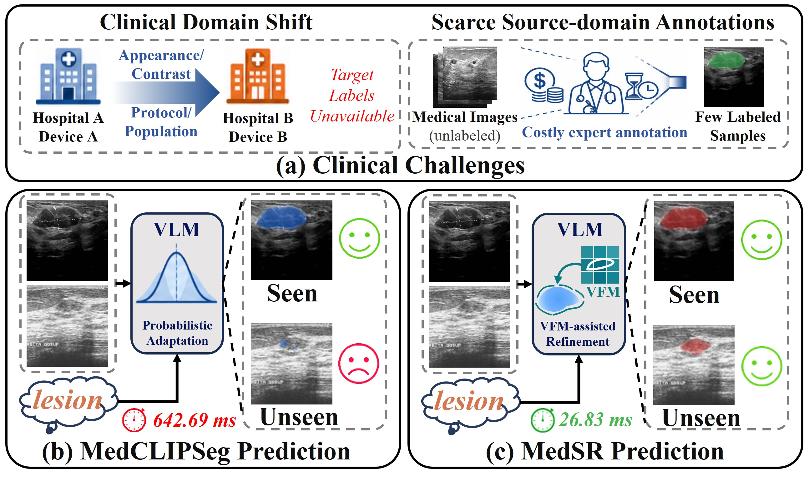
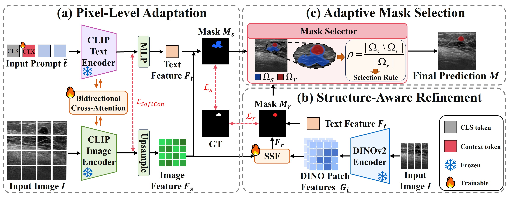
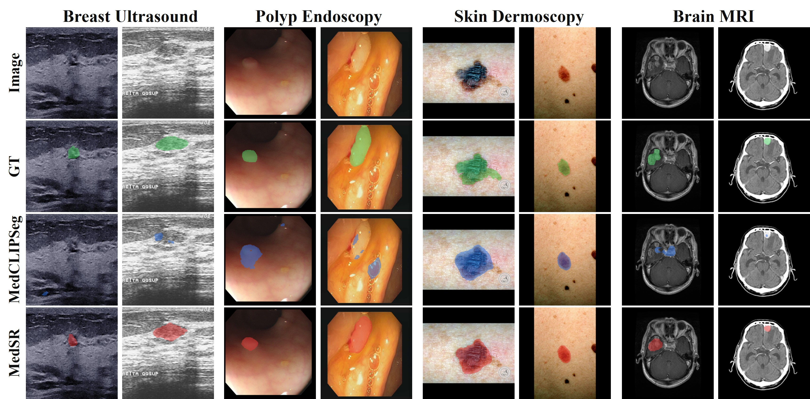
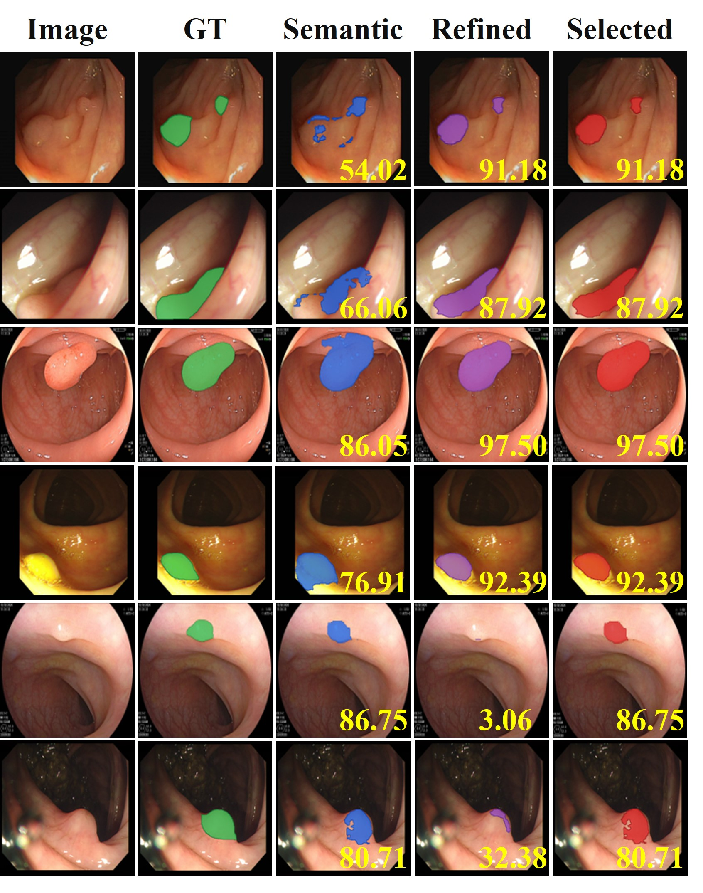

# MedSR: Selective Refinement for Data-Efficient and Generalizable Medical Image Segmentation

This repository contains the official PyTorch implementation of MedSR.

## Overview

<p align="center">
  
</p>

> **Abstract:** Medical image segmentation remains challenging due to scarce pixel-level annotations, ambiguous target boundaries, and domain shifts. Vision-language models offer strong cross-modal representations, but their image-level representations may not sufficiently capture the spatial details required for pixel-level medical segmentation. This motivates adapting transferable semantics to pixel-level prediction to improve target localization and spatial detail. In this paper, we propose MedSR, a selective refinement framework for data-efficient and generalizable medical image segmentation, which comprises three components, including Pixel-Level Adaptation, Structure-Aware Refinement, and Adaptive Mask Selection. Pixel-Level Adaptation introduces learnable textual context and bidirectional cross-attention to adapt vision-language representations for pixel-level segmentation, providing a semantic-aware target mask. Then, Structure-Aware Refinement fuses multi-level features from a frozen vision foundation model and semantic-aware features to generate a structure-refined target mask. During refinement, we also observe that foreground regions captured by the semantic-aware mask may be lost, leading to mask collapse. Adaptive Mask Selection therefore chooses between the semantic-aware and structure-refined target masks to mitigate this risk. Extensive experiments on ten unseen target datasets and four source datasets spanning four imaging modalities demonstrate the generalizability and data efficiency of MedSR. MedSR achieves an average Dice similarity coefficient of 80.03% across ten unseen target datasets and 82.41% across four source datasets using only 10% of their annotations. It requires only 26.83 ms per image on a single A6000, yielding a 23.95× inference speedup over MedCLIPSeg.

## Method

<p align="center">
  
  <br>
  <em>Overall architecture of MedSR.</em>
</p>

1. **Pixel-Level Adaptation (PLA):** inserts learnable context tokens into the text prompt and applies standard bidirectional cross-attention between frozen UniMedCLIP image and text features to produce a semantic-aware mask.

2. **Structure-Aware Refinement (SAR):** extracts multi-level patch features from a frozen DINOv2 encoder and fuses them with semantic features through Semantic-Structural Fusion to generate a structure-refined mask.

3. **Adaptive Mask Selection (AMS):** measures the target loss from the semantic mask to the refined mask. When the mask-collapse factor is at least 0.75, AMS retains the semantic mask; otherwise, it selects the refined mask.

## Results

Results are reported as Dice similarity coefficient (DSC, %). Bold entries indicate the best result.

### Table 1. Domain Generalization

| Method | BUSBRA | BUSUC | BUID | UDIAT | ColonDB | ClinicDB | CVC300 | BKAI | BRISC | UWaterloo | AVG |
| --- | ---: | ---: | ---: | ---: | ---: | ---: | ---: | ---: | ---: | ---: | ---: |
| LViT | 59.41 | 67.95 | 53.51 | 65.60 | 60.01 | 75.27 | 70.22 | 67.17 | 71.86 | 58.87 | 64.99 |
| CLIPSeg | 63.66 | 75.03 | 68.43 | 56.67 | 59.93 | 71.49 | 72.74 | 66.46 | 77.61 | 80.19 | 69.22 |
| DenseCLIP | 53.34 | 70.97 | 63.53 | 54.93 | 56.38 | 68.08 | 64.71 | 61.63 | 34.12 | 53.39 | 58.11 |
| ZegCLIP | 61.08 | 73.57 | 71.75 | 52.41 | 53.46 | 69.75 | 60.73 | 65.60 | 66.31 | 38.60 | 61.33 |
| SAN | 64.37 | 74.15 | 58.13 | 61.98 | 61.82 | 74.46 | 80.36 | 69.31 | 71.60 | 82.51 | 69.87 |
| MaPLe | 50.08 | 71.52 | 70.77 | 57.81 | 48.09 | 59.64 | 63.80 | 56.94 | 45.19 | 69.12 | 59.30 |
| MaPLe + Decoder | 55.89 | 64.96 | 60.66 | 59.44 | 61.53 | 71.20 | 74.62 | 66.93 | 71.46 | 81.83 | 66.85 |
| VLSM-Adapter | 68.48 | 82.37 | 75.26 | 69.16 | 63.51 | 76.09 | 75.24 | 71.59 | 68.92 | 82.17 | 73.28 |
| CausalCLIPSeg | 55.87 | 69.12 | 64.49 | 48.90 | 41.65 | 57.54 | 45.77 | 52.56 | 53.96 | 48.73 | 53.86 |
| CAT-Seg | 70.94 | 81.48 | 73.37 | 70.30 | 68.49 | 70.35 | 78.12 | 74.35 | 76.28 | 82.02 | 74.57 |
| MedCLIPSeg | 75.06 | 84.37 | 78.99 | 74.64 | 71.90 | 80.80 | 80.82 | 79.15 | **80.92** | **83.53** | 79.02 |
| **MedSR** | **75.60** | **85.12** | **81.06** | **75.73** | **72.10** | **82.43** | **86.95** | **80.21** | 79.73 | 81.32 | **80.03** |

BUSI, Kvasir, BTMRI, and ISIC are the source datasets for Breast, Polyp, Brain, and Skin, respectively.

### Table 2. Data Efficiency

| Method | 10% DSC | 25% DSC | 50% DSC |
| --- | ---: | ---: | ---: |
| U-Net | 58.48 | 62.75 | 75.23 |
| UNet++ | 61.28 | 69.93 | 76.67 |
| DeepLabv3 | 58.54 | 67.39 | 71.88 |
| Attention U-Net | 60.24 | 66.92 | 73.71 |
| nnU-Net | 75.15 | 79.07 | 81.82 |
| Swin-UNet | 49.75 | 56.65 | 58.80 |
| TransUNet | 56.64 | 60.52 | 61.34 |
| LViT | 60.50 | 73.02 | 77.36 |
| Ariadne's Thread | 58.87 | 60.49 | 63.69 |
| CLIPSeg | 72.90 | 76.35 | 77.88 |
| DenseCLIP | 69.48 | 72.62 | 75.70 |
| ZegCLIP | 66.12 | 68.60 | 73.22 |
| SAN | 75.23 | 78.43 | 81.18 |
| MaPLe | 68.04 | 74.10 | 76.20 |
| MaPLe + Decoder | 71.21 | 77.44 | 81.33 |
| CausalCLIPSeg | 67.63 | 72.12 | 76.39 |
| CAT-Seg | 77.14 | 80.72 | 82.68 |
| VLSM-Adapter | 73.90 | 77.22 | 81.60 |
| MedCLIPSeg | 78.82 | 84.22 | 86.89 |
| **MedSR** | **82.41** | **85.03** | **87.18** |

DSC is averaged across the BUSI, Kvasir, BTMRI, and ISIC source domains.

### Visualization

<p align="center">
  
  <br>
  <em>Qualitative comparison across breast ultrasound, polyp endoscopy, skin dermoscopy, and brain MRI. Green, blue, and red overlays indicate ground truth, MedCLIPSeg, and MedSR, respectively.</em>
</p>

<p align="center">
  
  <br>
  <em>Examples of Adaptive Mask Selection. It accepts beneficial refinement and returns the semantic mask when refinement collapses.</em>
</p>

## Model Checkpoints

Task-specific MedSR checkpoints are available on [Hugging Face](https://huggingface.co/wk1300092160/MedSR).

| Checkpoint | Status | Local location |
| --- | --- | --- |
| Domain-generalization weights | [Download](https://huggingface.co/wk1300092160/MedSR) | `<output-dir>/ALL_multi_run/<GROUP>/run_<RUN>/<SOURCE>/trained_models/seed<SEED>/` |
| Data-efficiency weights | [Download](https://huggingface.co/wk1300092160/MedSR) | `<output-dir>/<SOURCE>_<PERCENT>/trained_models/seed<SEED>/` |

The released checkpoints preserve the output layout generated by the paper scripts. For example, the full-supervision BUSI checkpoint evaluated with seed 666 is located at:

```text
outputs/medsr/ALL_multi_run/BUS/run_1/BUSI/trained_models/seed666/MedSR_ViT-B-16.pth
```

## Installation

This codebase is tested with Python 3.10 and a CUDA-compatible NVIDIA GPU. Follow the steps below to create the environment and install dependencies.

- Set up a conda environment (recommended):

```bash
# Create a conda environment
conda create -n medsr python=3.10 -y

# Activate the environment
conda activate medsr

# Install PyTorch and torchvision.
# Replace cu126 with the CUDA version compatible with your system if needed.
pip install torch==2.9.0 torchvision==0.24.0 --index-url https://download.pytorch.org/whl/cu126
```

- Enter the MedSR repository and install the remaining requirements:

```bash
cd MedSR
pip install -r requirements.txt
```

## Data Preparation

We follow the dataset splits and prompt-spreadsheet format of [MedCLIPSeg](https://github.com/HealthX-Lab/MedCLIPSeg). Download the datasets from their original sources and organize each dataset under `data/<DATASET>/`:

```text
data/<DATASET>/{Train_Folder,Val_Folder,Test_Folder,Prompts_Folder}/
```

Each split folder contains `img/` and `label/`. Prompt spreadsheets contain `Image`, `Ground Truth`, and `Description` columns.

## Training and Evaluation

```bash
# Train one BUS domain-generalization run (matches the released directory layout)
python train.py --config-file configs/BUSI.yaml --output-dir outputs/medsr/ALL_multi_run/BUS/run_1 --seed 666

# Evaluate the released BUSI checkpoint on BUSI
python test.py --config-file configs/BUSI.yaml --output-dir outputs/medsr/ALL_multi_run/BUS/run_1 --source_dataset BUSI --seed 666 --checkpoint PATH_to_Checkpoint 
python utils/eval.py --config-file configs/BUSI.yaml --output-dir outputs/medsr/ALL_multi_run/BUS/run_1 --seed 666
```

For BUS domain generalization, replace `configs/BUSI.yaml` with the target configuration while keeping `--source_dataset BUSI` and the same `--output-dir`. To reproduce the paper protocols:

```bash
# Four-source data-efficiency experiments
bash scripts/efficiency-all.sh outputs-10/medsr CORE 10 666
bash scripts/efficiency-all.sh outputs-25/medsr CORE 25 666
bash scripts/efficiency-all.sh outputs-50/medsr CORE 50 666

# Domain-generalization experiment
bash scripts/domain_generalization-all.sh outputs/medsr ALL 666 1
```

## Citation

The official citation will be added when the paper is publicly available.

## Acknowledgements

This repository reuses the experimental infrastructure and dataset/prompt organization of [MedCLIPSeg](https://github.com/HealthX-Lab/MedCLIPSeg), and uses [UniMed-CLIP](https://arxiv.org/abs/2412.10372), [DINOv2](https://github.com/facebookresearch/dinov2), and [OpenCLIP](https://github.com/mlfoundations/open_clip).
